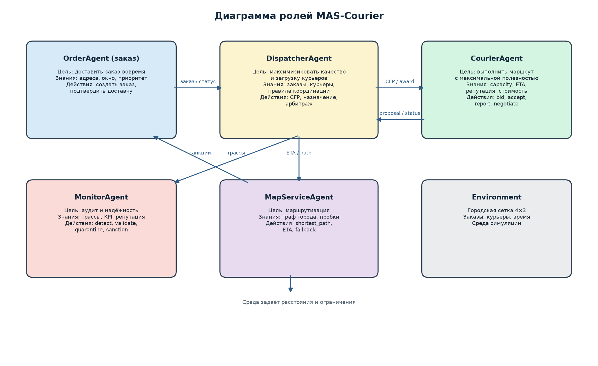
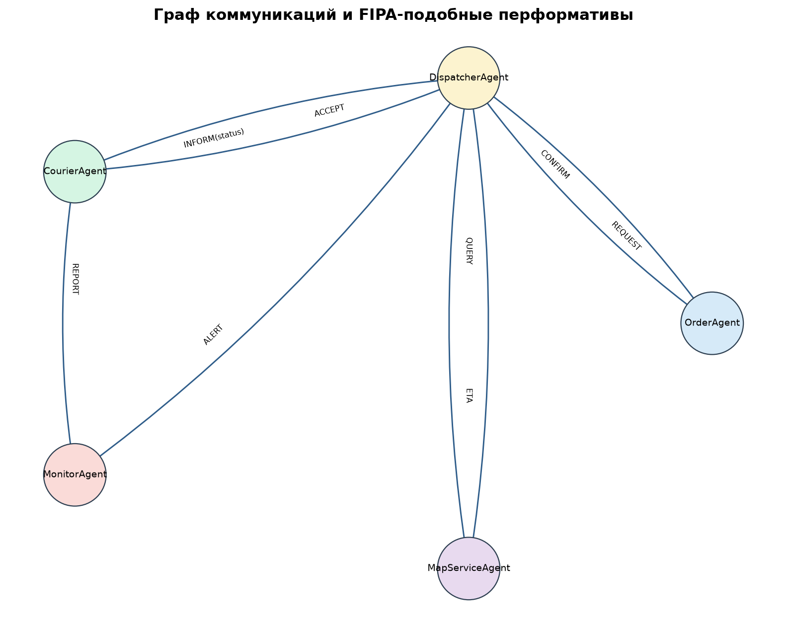
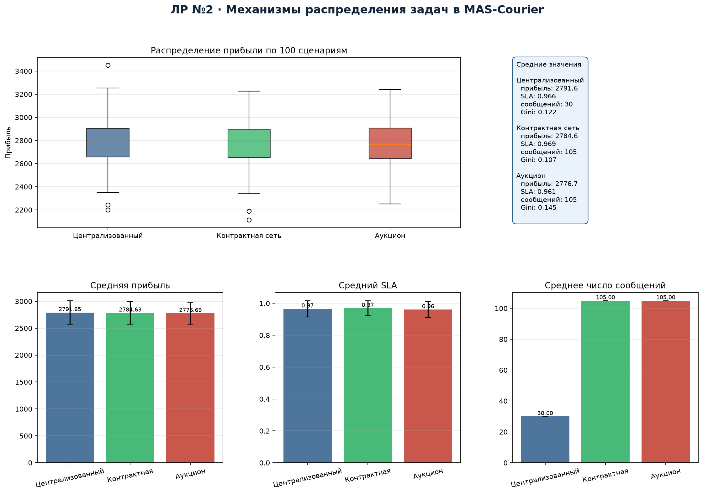
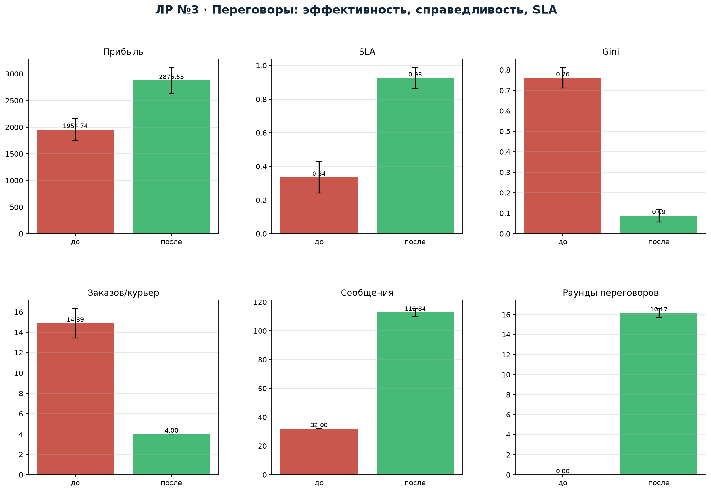
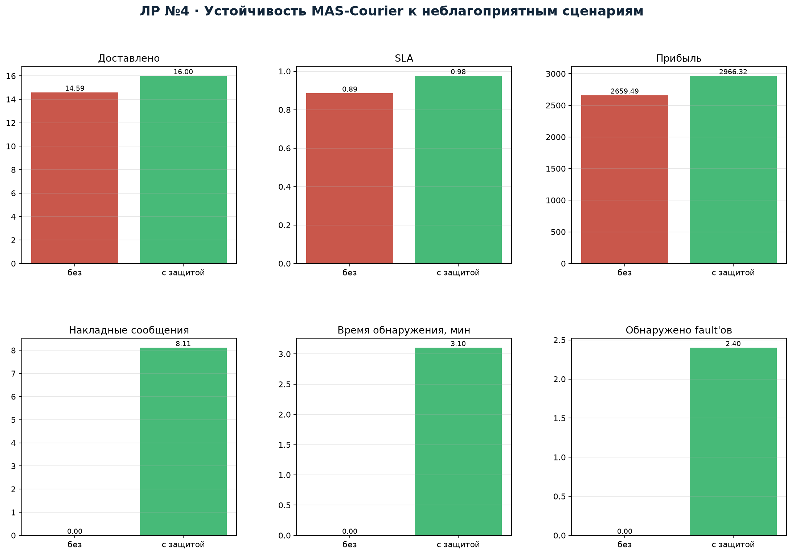

# MAS-Courier
## Многоагентная система оперативной курьерской доставки


**Студент:** Якимов Максим Андреевич  
**Группа:** Б24-517, № 31  
**Дисциплина:** «Теория многоагентных систем»

---

## О проекте

MAS-Courier — учебная многоагентная система для распределения заказов
курьерской доставки. В системе пять ролей: заказ, диспетчер, курьер, монитор
и картографический сервис. Реализованы три механизма распределения,
протокол переговоров, инъекция неблагоприятных сценариев и защитные
механизмы.

Проект покрывает все четыре лабораторные работы:

| ЛР | Тема | Отчёт |
|---|---|---|
| 1 | Спецификация и архитектурное проектирование МАС | [`reports/Lab1.pdf`](reports/Lab1.pdf) |
| 2 | Механизмы распределения задач и координации | [`reports/Lab2.pdf`](reports/Lab2.pdf) |
| 3 | Переговоры и разрешение конфликтов | [`reports/Lab3.pdf`](reports/Lab3.pdf) |
| 4 | Диверсионный анализ и надёжность | [`reports/Lab4.pdf`](reports/Lab4.pdf) |

## Архитектура





- `OrderAgent` — представляет заказ и его окно доставки.
- `DispatcherAgent` — глобальная координация, CFP/аукцион, арбитраж.
- `CourierAgent` — локальная полезность, capacity, ETA, переговоры.
- `MonitorAgent` — трассы, репутация, обнаружение аномалий, карантин.
- `MapServiceAgent` — кратчайшие пути и fallback при отказе.

Архитектура гибридная: централизованный диспетчер для системных
ограничений + рыночные механизмы для локальных решений.

## Результаты

### ЛР №2 — механизмы распределения (100 сценариев)



| Механизм | Прибыль | SLA | Сообщений | Gini |
|---|---:|---:|---:|---:|
| Централизованный | **2791.6** | 0.966 | **30** | 0.122 |
| Контрактная сеть | 2784.6 | **0.969** | 105 | **0.107** |
| Аукцион | 2776.7 | 0.961 | 105 | 0.145 |

### ЛР №3 — переговоры (100 сценариев)



| Механизм | Прибыль | SLA | Gini | Макс. заказов |
|---|---:|---:|---:|---:|
| FCFS (до) | 1954.7 | 0.335 | 0.762 | 14.89 |
| Переговоры (после) | **2875.6** | **0.926** | **0.088** | **4.00** |

### ЛР №4 — надёжность (100 сценариев)



| Режим | Доставлено | SLA | Прибыль | Накладные сообщения |
|---|---:|---:|---:|---:|
| Без защиты | 14.59 | 0.886 | 2659.5 | 0 |
| С защитой | **16.00** | **0.976** | **2966.3** | 8.11 |

## Быстрый запуск

```bash
pip install -r requirements.txt

# диаграммы архитектуры
python main.py lab1

# демонстрационный запуск
python main.py demo --mechanism contract_net --seed 42

# эксперименты
python main.py lab2 --scenarios 100
python main.py lab3 --scenarios 100
python main.py lab4 --scenarios 100

# всё сразу
python main.py all --scenarios 100
```

Результаты сохраняются в `results/`.

## Веб-демонстрация

```bash
python web_demo.py
```

Откройте `http://localhost:8000`. В интерфейсе можно выбрать механизм
(`centralized`, `contract_net`, `auction`, `fcfs`, `negotiation`), seed,
число заказов и курьеров, включить режим «с защитой» и посмотреть метрики,
план и журнал событий. Сервер использует только стандартную библиотеку
Python и не требует внешних зависимостей.

## Структура проекта

```
MAS_Courier/
├── main.py                 # CLI: lab1 / demo / lab2 / lab3 / lab4 / all
├── web_demo.py             # веб-демонстрация на stdlib http.server
├── mas/
│   ├── model.py            # граф города, заказы, курьеры, симуляция
│   ├── protocols.py        # centralized, CNP, auction, FCFS, переговоры
│   ├── faults.py           # инъекция faults и защита
│   ├── experiments.py      # серии экспериментов ЛР №2–№4
│   └── viz.py              # диаграммы и графики
├── results/                # CSV, PNG, трассы
├── reports/                # Lab1–Lab4: Markdown + PDF
└── README.md
```

## Метрики

- прибыль = вознаграждение − транспортные затраты − стоимость координации;
- SLA — доля заказов, доставленных вовремя;
- makespan — время завершения последнего заказа;
- число сообщений и стоимость координации;
- Gini неравенства заработков;
- утилизация смены;
- для ЛР №4 — доля доставленных, время обнаружения, накладные сообщения.

## Лицензия и данные

Все данные синтетические, генерируются по seed. Внешние библиотеки —
NumPy, SciPy, Matplotlib, NetworkX (см. `requirements.txt`).
