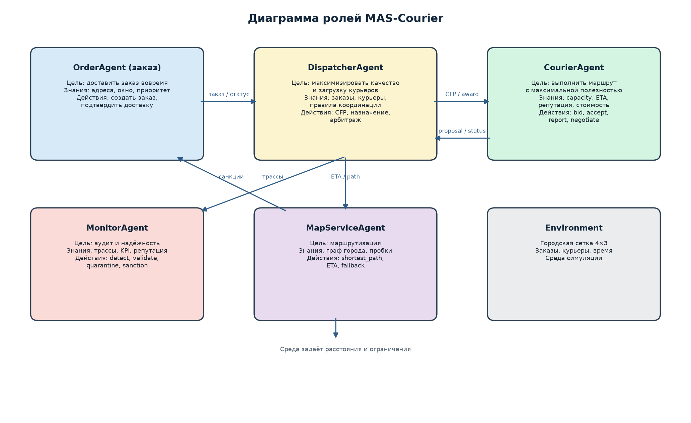
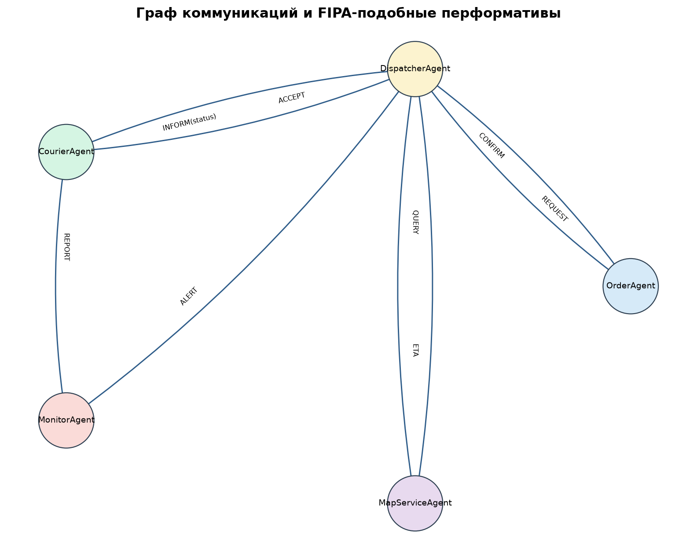

---
title: "Отчёт по лабораторной работе №1"
subtitle: "Спецификация и архитектурное проектирование многоагентной системы MAS-Courier"
author: "Якимов Максим Андреевич, группа Б24-517, № 31"
date: "2026"
lang: ru
---

# 1. Прикладная задача

Выбрана задача оперативной курьерской доставки в городе. Имеется набор
заказов (ресторан → клиент) с адресами, окном доставки, приоритетом, весом и
вознаграждением; набор курьеров с грузоподъёмностью, скоростью, стоимостью
минуты, надёжностью и сменой. Требуется распределить заказы между курьерами,
построить маршруты и выполнить доставку, максимизируя прибыль и долю
своевременных доставок при ограничениях на вместимость и смену.

Задача допускает все четыре лабораторные работы: сравнение механизмов
распределения (ЛР №2), конфликт интересов и переговоры (ЛР №3), инъекцию
неблагоприятных сценариев и защиту (ЛР №4). Поэтому перепроектирование между
работами не требуется.

# 2. Формальное описание МАС

## 2.1. Агенты и роли

| Агент | Роль и цель | Знания | Состояния и действия | Полномочия |
|---|---|---|---|---|
| `OrderAgent` | представитель заказа; доставить вовремя | адреса, окно, приоритет, вес | создан → назначен → доставлен / отменён; создать, подтвердить, сообщить статус | менять только свой заказ |
| `DispatcherAgent` | координатор; максимизировать качество и загрузку | все заказы, курьеры, правила | ожидание → распределение → арбитраж; CFP, назначение, переговоры | назначать заказы, инициировать торги |
| `CourierAgent` | исполнитель; выполнить маршрут с полезностью | capacity, ETA, стоимость, репутация | свободен → занят → на смене / вне смены; bid, accept, отчёт | принимать/отклонять, сообщать статус |
| `MonitorAgent` | аудитор; надёжность и справедливость | трассы, KPI, репутация | мониторинг → тревога → карантин; detect, validate, sanction | блокировать агента, штрафовать |
| `MapServiceAgent` | маршрутизатор; кратчайшие пути и ETA | граф города, пробки | доступен / деградация; shortest_path, ETA, fallback | только чтение графа |

## 2.2. Среда

Город — сетка $4\times3$ (12 узлов). Расстояние между соседними узлами —
4 минуты; курьер движется со своей скоростью. Время дискретизировано по
минутам; погрузка/разгрузка — 3 минуты. Заказ считается выполненным, если
курьер доставил его до дедлайна; за опоздание начисляется половинное
вознаграждение.

## 2.3. Каналы связи и перформативы

Используется FIPA-подобный набор перформативов: `REQUEST`, `CFP`,
`PROPOSE`, `ACCEPT`, `REJECT`, `INFORM`, `ALERT`, `QUERY`. Каналы:
заказ ↔ диспетчер, диспетчер ↔ курьер, курьер ↔ монитор, диспетчер ↔
картографический сервис. Сообщения асинхронные, с идентификатором заказа и
версией, что важно для защиты от противоречивых указаний.

## 2.4. Правила взаимодействия

1. Заказ создаётся `OrderAgent` и регистрируется у диспетчера.
2. Диспетчер выбирает механизм: централизованное назначение, контрактная
   сеть или аукцион.
3. Курьер может принять заказ только при выполнении capacity и смены;
   проверка выполняется и курьером, и диспетчером.
4. При конфликте нескольких заказов на одного курьера запускаются переговоры
   (ЛР №3); при отсутствии согласия — арбитраж по приоритету, надёжности и
   загрузке.
5. Монитор получает отчёты и трассы, может инициировать карантин и санкции.
6. Все назначения идемпотентны: повторное сообщение с той же версией не
   создаёт дубль.

# 3. Диаграмма ролей

# 4. Граф коммуникаций

# 5. Обоснование архитектуры

Выбрана **гибридная архитектура**: централизованный диспетчер для глобальной
оптимизации и контрактная сеть/аукцион для локальных решений курьеров.
Централизация упрощает соблюдение системных ограничений (бюджет, смена,
приоритеты), а рыночные механизмы дают курьерам возможность сообщать свою
стоимость и загрузку. Монитор вынесен в отдельного агента, чтобы аудит и
защита не зависели от диспетчера — это ключевое требование для ЛР №4.

Архитектура поддерживает:

- ЛР №2 — сменные модули `centralized`, `contract_net`, `auction`;
- ЛР №3 — протокол переговоров и арбитраж;
- ЛР №4 — трассы, репутацию, карантин, токены владения и fallback карт.

# 6. Вывод

Спроектирована МАС из пяти ролей с явными целями, знаниями, состояниями,
действиями и полномочиями. Определены каналы, перформативы и правила
взаимодействия. Архитектура гибридная: диспетчер отвечает за глобальные
ограничения, курьеры — за локальную полезность, монитор — за надёжность.
Система реализована на Python и допускает демонстрацию в разных режимах
через CLI и веб-интерфейс.

Исходный код, результаты и веб-демонстрация:
<https://github.com/yakimak/MAS_Courier>.  
Онлайн-демо: <https://yakimak.github.io/MAS_Courier/>.

