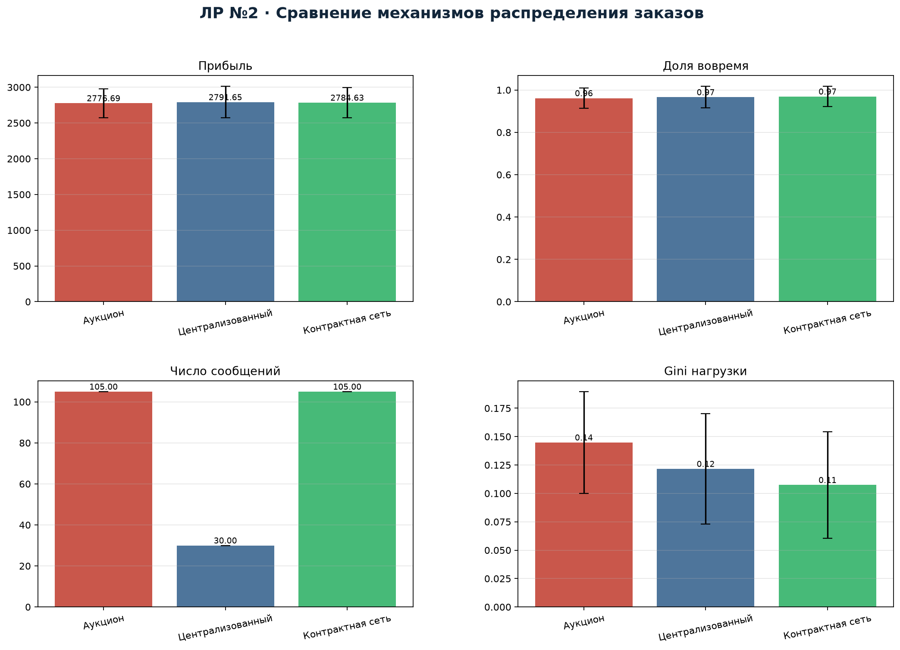
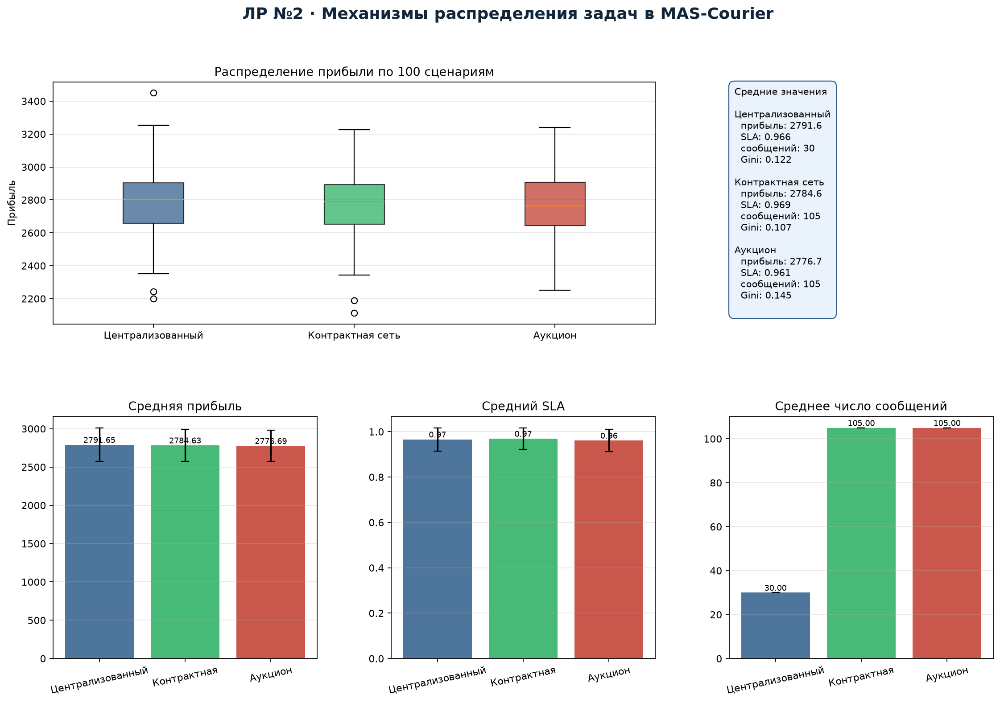

---
title: "Отчёт по лабораторной работе №2"
subtitle: "Исследование механизмов распределения задач и координации в MAS-Courier"
author: "Якимов Максим Андреевич, группа Б24-517, № 31"
date: "2026"
lang: ru
---

# 1. Цель и постановка эксперимента

Цель — реализовать и экспериментально сравнить не менее двух механизмов
распределения заказов в MAS-Courier. Сравниваются три механизма:

1. **Централизованная диспетчеризация** — диспетчер последовательно
   назначает заказы, выбирая курьера с минимальным приростом времени
   выполнения; сообщений минимум, но нет торгов.
2. **Контрактная сеть (CNP)** — диспетчер рассылает CFP, курьеры присылают
   предложения (ETA, стоимость, надёжность), диспетчер выбирает лучший
   многокритериальный оффер.
3. **Аукцион первой цены** — курьеры присылают ценовые ставки, побеждает
   минимальная ставка; учитывается загрузка и случайная наценка.

Эксперимент: 100 независимых сценариев (seed 0…99), в каждом 15 заказов и
5 курьеров. Для всех механизмов используются одни и те же сценарии, что
обеспечивает честное сравнение. Стоимость одного сообщения — 0.15 у.е.

# 2. Метрики

- прибыль $=$ вознаграждение $-$ транспортные затраты $-$ стоимость координации;
- SLA (доля заказов, доставленных вовремя);
- makespan (время завершения последнего заказа);
- число сообщений и стоимость координации;
- Gini неравенства заработков курьеров;
- утилизация смены;
- суммарное опоздание.

# 3. Результаты

| Механизм | Прибыль | SLA | Сообщений | Gini |
|---|---:|---:|---:|---:|
| Централизованный | **2791.6** | 0.966 | **30** | 0.122 |
| Контрактная сеть | 2784.6 | **0.969** | 105 | **0.107** |
| Аукцион | 2776.7 | 0.961 | 105 | 0.145 |

Makespan: 80.1 мин у централизованного, 80.0 у CNP, 86.7 у аукциона.
Стоимость координации: 4.50 у.е. у централизованного и 15.75 у.е. у CNP и
аукциона.

# 4. Анализ

**Централизованный механизм** даёт максимальную прибыль (2791.6) и минимальное
число сообщений (30), а также лучший makespan (80.1 мин). Это ожидаемо:
диспетчер имеет полную информацию и не тратит сообщения на торги. Однако
Gini 0.122 выше, чем у CNP: централизованное назначение менее равномерно
распределяет заработок.

**Контрактная сеть** немного уступает по прибыли (2784.6, разница 0.25 %),
но даёт лучший SLA (0.969) и минимальный Gini (0.107). Многокритериальные
предложения позволяют учитывать надёжность и загрузку курьеров, поэтому
распределение справедливее. Плата — 105 сообщений и 15.75 у.е. координации,
то есть в 3.5 раза больше, чем у централизованного механизма.

**Аукцион** показывает худший SLA (0.961) и наибольший Gini (0.145):
ценовая ставка не учитывает надёжность и будущую загрузку, поэтому часть
заказов достаётся курьерам с неудачным ETA. Прибыль также минимальна
(2776.7). Аукцион имеет смысл, когда важна цена, а не SLA.

Статистические тесты Манна—Уитни по 100 сценариям приведены в
`results/lab2_tests.csv`; различия по прибыли между механизмами малы, тогда
как по числу сообщений и Gini они устойчивы.

# 5. Компромисс «эффективность — координация»

Результаты показывают классический компромисс. Централизация минимизирует
коммуникацию и даёт лучшую прибыль, но хуже по справедливости. Контрактная
сеть повышает SLA и справедливость ценой роста сообщений в 3.5 раза.
Аукцион не даёт выигрыша ни по прибыли, ни по SLA в данной модели, поэтому
для MAS-Courier рекомендуется CNP при приоритете SLA/справедливости и
централизованный режим — при жёстком лимите на коммуникацию.

# 6. Вывод

Реализованы и сравнены три механизма распределения задач. Централизованный
механизм эффективен по прибыли и сообщениям, контрактная сеть — по SLA и
справедливости, аукцион проигрывает по SLA. Выбор механизма зависит от
целевой функции системы; в дальнейшем используется CNP как базовый, а
переговоры (ЛР №3) надстраиваются над ним для разрешения конфликтов.

