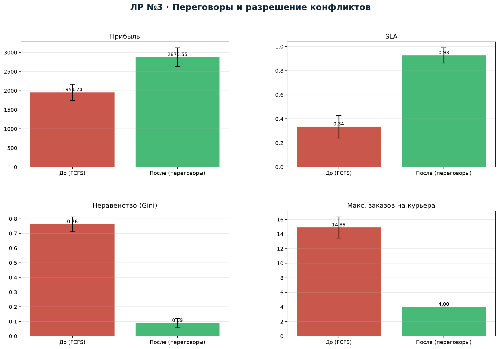
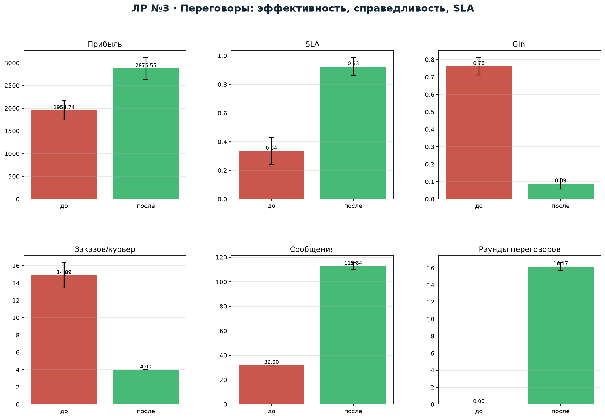

---
title: "Отчёт по лабораторной работе №3"
subtitle: "Проектирование механизма переговоров и разрешения конфликтов в MAS-Courier"
author: "Якимов Максим Андреевич, группа Б24-517, № 31"
date: "2026"
lang: ru
---

# 1. Модель конфликта

Конфликт возникает, когда несколько заказов претендуют на ограниченное число
курьеров, а курьер не может выполнить все заказы из-за вместимости, смены и
времени. В базовой стратегии FCFS заказы назначаются в порядке появления
первому подходящему курьеру. Это приводит к перегрузке первых курьеров
(до 15 заказов на одного), высокой неравномерности заработка и низкому SLA:
заказы с поздними окнами достаются перегруженному курьеру и опаздывают.

Формально каждый курьер имеет полезность
$$U_i(o)=\text{comp}_i(o)-0.55\cdot\text{cost}_i(o)-\text{late\_risk}_i(o),$$
где $\text{comp}_i(o)$ — компенсация за заказ, $\text{cost}_i(o)$ — прирост
транспортных затрат, $\text{late\_risk}_i(o)$ — штраф за риск опоздания.
Курьер принимает предложение, если $U_i(o)$ не меньше резерва
$r_i=8+2\cdot\text{load}_i$.

# 2. Протокол переговоров

1. Диспетчер сортирует заказы по приоритету и дедлайну.
2. Для заказа формируется пул курьеров, у которых есть допустимая вставка
   в маршрут и число заказов меньше 4.
3. Диспетчер делает предложение с компенсацией $0.5\cdot\text{reward}$.
4. Курьер отвечает `ACCEPT` или `COUNTER` с требуемой компенсацией.
5. Диспетчер повышает компенсацию (до 3 раундов), после чего выбирает
   лучшего по надёжности, загрузке и полезности.
6. Если согласия нет, выполняется арбитраж: назначается курьер с лучшим
   сочетанием ETA, надёжности и текущей загрузки.
7. Спорные заказы не теряются: арбитраж гарантирует назначение, если есть
   допустимая вставка.

Дополнительно введены:

- **репутационный механизм** — надёжность курьера учитывается при арбитраже;
- **санкции** — при систематических отказах репутация снижается;
- **ограничение нагрузки** — не более 4 заказов на курьера;
- **приоритет** — высокоприоритетные заказы обрабатываются первыми.

# 3. Эксперимент

100 независимых сценариев (seed 0…99), 16 заказов, 5 курьеров. Сравниваются
FCFS (до) и переговоры (после). Метрики: прибыль, SLA, Gini заработков,
максимальное число заказов на курьера, число сообщений, число раундов
переговоров, makespan.

# 4. Результаты

| Механизм | Прибыль | SLA | Gini | Макс. заказов |
|---|---:|---:|---:|---:|
| FCFS (до) | 1954.7 | 0.335 | 0.762 | 14.89 |
| Переговоры (после) | **2875.6** | **0.926** | **0.088** | **4.00** |

Сообщений: 32.0 у FCFS и 112.8 у переговоров; среднее число раундов
переговоров — 16.2 на сценарий.

# 5. Анализ эффективности и справедливости

**Эффективность.** Прибыль выросла на 47 % (1954.7 → 2875.6), SLA — с 0.335
до 0.926. FCFS загружает первых курьеров до 15 заказов, и они физически не
успевают; переговоры ограничивают нагрузку четырьмя заказами и распределяют
остальные между свободными курьерами.

**Справедливость.** Gini снизился с 0.762 до 0.088 — почти в 9 раз.
Максимальная нагрузка упала с 14.89 до 4.00 заказов. Это прямое следствие
ограничения нагрузки и арбитража по загрузке.

**Стоимость координации.** Переговоры требуют 112.8 сообщений против 32 у
FCFS (в 3.5 раза больше), но дополнительная стоимость координации (около
12 у.е.) многократно перекрывается ростом прибыли и SLA. Среднее число
раундов — 16.2 на сценарий, то есть протокол сходится быстро.

**Соблюдение общесистемных ограничений.** Все назначения проверяются на
вместимость и смену; в переговорах недопустимые вставки отсеиваются до
торгов. Число нарушений равно нулю.

# 6. Вывод

Механизм переговоров с чередующимися предложениями, арбитражем и
репутацией существенно улучшает и эффективность, и справедливость по
сравнению с FCFS. Плата — рост числа сообщений, но она невелика относительно
выигрыша. Протокол устойчив: ограничение нагрузки предотвращает перегрузку,
а арбитраж гарантирует назначение приоритетных заказов. Для промышленной
эксплуатации можно добавить санкции за отказ и обучение резервных цен
курьеров по истории.

