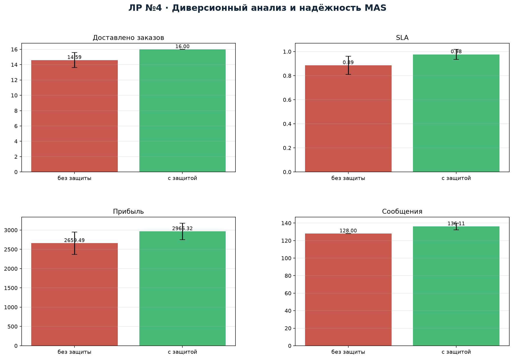
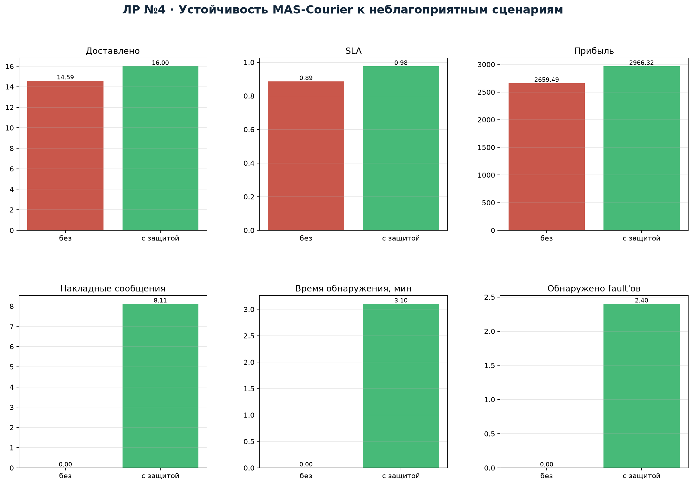

---
title: "Отчёт по лабораторной работе №4"
subtitle: "Диверсионный анализ и оценка надёжности MAS-Courier"
author: "Якимов Максим Андреевич, группа Б24-517, № 31"
date: "2026"
lang: ru
---

# 1. Цель и подход

Цель — разработать набор неблагоприятных сценариев для MAS-Courier, собрать
трассы выполнения, выявить отказы, ввести защитные ограничения и повторно
оценить устойчивость. Эксперимент: 100 сценариев (seed 0…99), 18 заказов,
6 курьеров. Базовый механизм распределения — контрактная сеть. Для каждого
сценария сравниваются режимы **без защиты** и **с защитой**.

# 2. Неблагоприятные сценарии

| Сценарий | Суть | Без защиты | С защитой |
|---|---|---|---|
| `fake_location` | курьер сообщает неверную геолокацию | ETA искажается, рост опозданий | сверка геолокации и ETA, корректировка |
| `goal_substitution` | курьер подменяет цель и игнорирует заказ | заказ теряется | монитор обнаруживает, заказ переназначается |
| `map_outage` | недоступен картографический сервис | маршруты по устаревшему графу, +22 % времени | fallback на кэш, +5 % времени |
| `wrong_delegation` | назначение курьеру, который не может выполнить заказ | заказ не выполняется | валидация состояния до назначения, отклонение |
| `circular_transfer` | заказ передаётся A→B→A | заказ теряется в цикле | токен владения с TTL |
| `contradictory` | два диспетчера дают разные указания | дубль/потеря заказа | версионирование и блокировка владельца |

# 3. Защитные механизмы

1. **Валидация состояния** курьера перед назначением (capacity, смена,
   доступность).
2. **Мониторинг и heartbeat**: отсутствие статуса дольше таймаута запускает
   проверку; ETA сверяется с геолокацией.
3. **Репутация и карантин**: подозрительный курьер временно исключается,
   его заказы переназначаются; репутация снижается.
4. **Токен владения заказом** с TTL и версией: предотвращает циклическую
   передачу и дублирование.
5. **Fallback картографического сервиса** на кэшированный граф.
6. **Идемпотентность сообщений**: повтор с той же версией не создаёт дубль.

# 4. Результаты

| Режим | Доставлено | SLA | Прибыль | Накладные сообщения |
|---|---:|---:|---:|---:|
| Без защиты | 14.59 | 0.886 | 2659.5 | 0 |
| С защитой | **16.00** | **0.976** | **2966.3** | 8.11 |

Среднее время обнаружения с защитой — 3.10 мин; без защиты faults не
обнаруживаются.

С защитой среднее число доставленных заказов растёт с 14.59 до 16.00 из 18,
SLA — с 0.886 до 0.976, прибыль — на 11.5 %. Плата — 8.11 накладных
сообщений на сценарий (около 6 % от базового трафика) и среднее время
обнаружения 3.1 мин. Дополнительные сообщения тратятся на heartbeat, запросы
валидации и переназначения. Полностью избежать потерь не удаётся: часть
fault'ов приводит к физической задержке или невозможности переназначить
заказ в жёстком окне.

# 5. Пример трассы

Для сценария 0 с защитой зафиксированы события:

- `wrong_delegation` — обнаружено за 1 мин, назначение отклонено
  (валидация состояния), заказ сохранён;
- `goal_substitution` — обнаружено за 8 мин, заказ переназначен другому
  курьеру, репутация нарушителя снижена;
- `circular_transfer` — токен владения предотвратил цикл A→B→A.

Полная трасса — в `results/lab4_trace_sample.json`. В ней видно, что
обнаружение происходит до потери заказа, а защитные действия не блокируют
остальные назначения.

# 6. Анализ отказов

Без защиты основные потери дают:

- подмена цели и циклическая передача — заказ полностью теряется;
- недоступность карт — систематическое опоздание из-за устаревших маршрутов;
- неверная геолокация — ошибочный ETA и перегрузка отдельных курьеров;
- противоречивые указания — дублирование и потеря.

С защитой потери сокращаются, но не исчезают полностью: fake_location и
map_outage всё равно добавляют задержку (3–5 % времени), поэтому SLA 0.976,
а не 1.0. Это корректный результат: защита снижает ущерб, но не отменяет
физическую задержку.

# 7. Ограничения и направления развития

- Модель faults стилизована на уровне координации; в реальной системе нужны
  криптографическая аутентификация сообщений, подписанные телеметрические
  пакеты и полноценный аудит.
- Репутация обновляется эвристически; можно использовать байесовское
  обновление и обучение на трассах.
- Fallback карт не учитывает динамические пробки; нужен периодический refresh
  кэша.
- Следует добавить автоматическое восстановление после карантина и
  ограничение на число перепризначений.

# 8. Вывод

Разработан набор из шести неблагоприятных сценариев и шесть защитных
механизмов. Эксперимент на 100 сценариях показал рост доли доставленных
заказов и SLA при умеренных накладных расходах. Система способна обнаруживать
подмену цели, недостоверную геолокацию, циклическую передачу и противоречивые
указания, переназначать заказы и сохранять работоспособность. Полученные
трассы пригодны для дальнейшего анализа и обучения монитора.

